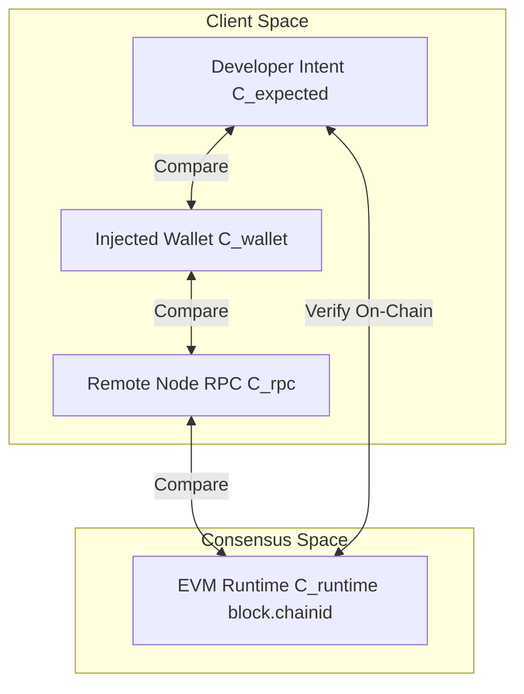

# ChainID Guard: Runtime Network Inspection and Configuration Verification Protocol

**A Decentralized Verification Standard for Eliminating Cross-Network Execution Hazards in EVM Environments**

*Target Network: Botchain Testnet (Chain ID: 968)*  
*Deployed Contract: `0x828a2a7a65f67AC30A7Ecc1d5f466fc28532Fe5E`*  
*Authors: ChainID Guard Research Team*  
*Repository: https://github.com/webtrovert0x/chainidguard*

---

## Abstract

In the multi-chain Ethereum Virtual Machine (EVM) ecosystem, developers and decentralized applications (dApps) routinely interface across heterogeneous execution environments—ranging from local sandboxes and public testnets to production mainnets. A recurring vulnerability in Web3 development stems from **cross-network configuration divergence**: a failure state where the developer's intended chain ID diverges from the connected wallet's active chain ID, the application's RPC endpoint, or the actual on-chain transaction execution context. Such desynchronizations lead to catastrophic consequences, including irreversible loss of mainnet capital, corrupted protocol state, simulation divergence, and failed smart contract deployments.

**ChainID Guard** introduces a lightweight, zero-protocol-fee verification system and inspection dApp designed to establish cryptographic certainty across all network configuration layers. By combining client-side JSON-RPC probing (`eth_chainId`), injected Web3 provider inspection (`window.ethereum`), and on-chain verification powered by the EVM `CHAINID` opcode (`block.chainid`, EIP-1344), ChainID Guard provides a deterministic 4-Way Verification Matrix that eliminates network mismatch risks prior to contract interaction or deployment.

---

## 1. Problem Statement

Modern EVM architectures separate transaction lifecycle management across four decoupled layers:
1. **Developer Intent Layer ($C_{\text{expected}}$)**: The network ID configured in developer toolchains (e.g., Hardhat, Foundry, Vite).
2. **User Agent / Wallet Layer ($C_{\text{wallet}}$)**: The active network selected in the injected wallet (e.g., MetaMask, Rabby, Coinbase Wallet).
3. **Transport / RPC Layer ($C_{\text{rpc}}$)**: The remote JSON-RPC node URL forwarding transactions and serving state queries.
4. **EVM Execution Layer ($C_{\text{runtime}}$)**: The blockchain environment where the consensus engine actually processes bytecode.



### 1.1 The Multi-Chain Divergence Dilemma

Because these layers communicate asynchronously across heterogeneous protocols, discrepancies frequently emerge:
- **Mainnet Hazard State**: A developer intending to test smart contracts on a testnet (e.g., Botchain Testnet, ID: 968) inadvertently initiates execution while their wallet provider remains anchored to Ethereum Mainnet (ID: 1). Real-value assets are consumed as gas or sent to unverified addresses.
- **Silent RPC Desynchronization**: The frontend application transmits read/simulate calls to an RPC node on Chain A while broadcasting transactions to Chain B. State simulations succeed falsely, while broadcast transactions fail with non-descriptive revert codes.
- **Chain ID Collision**: Local environments (e.g., Hardhat or Anvil with default ID `31337`) conflicting with public testnets, misleading dApp logic into misidentifying contract addresses.

---

## 2. The ChainID Guard Protocol

ChainID Guard formalizes network verification through a stateful smart contract (`ChainIDGuard.sol`) combined with a client-side inspection engine.

### 2.1 The 4-Way Verification Matrix

Let $\mathcal{N}$ denote the set of valid EVM chain identifiers:
$$\mathcal{N} = \{ c \in \mathbb{N} \mid 1 \le c < 2^{256} - 1 \}$$

For any interaction, we define the configuration vector:
$$\mathbf{C} = \left( C_{\text{expected}}, C_{\text{wallet}}, C_{\text{rpc}}, C_{\text{runtime}} \right) \in \mathcal{N}^4$$

The system evaluates the **System Consistency Predicate** $\Psi(\mathbf{C})$:
$$\Psi(\mathbf{C}) \iff \left( C_{\text{expected}} = C_{\text{wallet}} \right) \land \left( C_{\text{expected}} = C_{\text{rpc}} \right) \land \left( C_{\text{expected}} = C_{\text{runtime}} \right)$$

If $\Psi(\mathbf{C})$ is false, ChainID Guard classifies the failure into specific threat tiers:

| Failure Mode | Condition | Threat Level | Automated Action |
| :--- | :--- | :--- | :--- |
| **Mainnet Execution Hazard** | $C_{\text{wallet}} \in \mathcal{M}_{\text{main}} \land C_{\text{expected}} \notin \mathcal{M}_{\text{main}}$ | **CRITICAL** | Intercept broadcast, warn of real asset loss, prompt 1-click network switch. |
| **Wallet Mismatch** | $C_{\text{wallet}} \neq C_{\text{expected}}$ | **DANGER** | Halt transaction execution; trigger `wallet_switchEthereumChain`. |
| **RPC Desynchronization** | $C_{\text{rpc}} \neq C_{\text{expected}}$ | **WARNING** | Flag RPC divergence; invalidate cached state queries. |
| **Execution Divergence** | $C_{\text{runtime}} \neq C_{\text{expected}}$ | **CRITICAL** | Revert transaction confirmation; emit on-chain mismatch audit record. |

---

## 3. Smart Contract Architecture (`ChainIDGuard.sol`)

The `ChainIDGuard` smart contract acts as the immutable ground-truth oracle for network execution. 

### 3.1 Gas-Only Economic Model

To maximize accessibility and developer adoption, **all smart contract interactions are strictly non-payable ($msg.value == 0$)**. ChainID Guard charges zero protocol fees, commission, or token tolls. Interactions consume only standard EVM transaction gas paid directly to network validators.

### 3.2 Contract Specification

```solidity
// Core data models
struct CheckRequest {
    uint256 id;
    address requester;
    uint256 expectedChainId;
    uint256 timestamp;
    bool isResolved;
}

struct CheckResult {
    uint256 requestId;
    address requester;
    uint256 expectedChainId;
    uint256 actualChainId;
    bool isMatch;
    uint256 resolvedAtBlock;
    uint256 timestamp;
}
```

### 3.3 Core Functions

- **`requestNetworkCheck(uint256 expectedChainId) external returns (uint256 requestId)`**:
  Records the developer's expected chain ID, captures the executing network directly using the EVM opcode `block.chainid` (EIP-1344), records the result to storage, and emits `NetworkCheckRequested` and `NetworkCheckCompleted`.
  
- **`publishResult(uint256 requestId) external returns (CheckResult memory)`**:
  Provides an explicit re-evaluation or finalization mechanism to seal an inspection record on-chain.
  
- **`getRequest(uint256 requestId) external view returns (CheckRequest memory, CheckResult memory)`**:
  Permits retrospective auditability for any historical inspection nonce.

- **`getUserRequests(address user) external view returns (uint256[] memory)`**:
  Indexes all inspections performed by a specific developer wallet.

---

## 4. Primary Deployment: Botchain Testnet

ChainID Guard has been officially deployed to **Botchain Testnet**:

| Parameter | Value |
| :--- | :--- |
| **Network Name** | Botchain Testnet |
| **Chain ID** | `968` |
| **Native Token** | `BOT` (18 Decimals) |
| **RPC Endpoint** | `https://rpc.bohr.life` |
| **Block Explorer** | `https://scan.bohr.life` |
| **Contract Address** | `0x828a2a7a65f67AC30A7Ecc1d5f466fc28532Fe5E` |
| **Contract Verification** | [View on BohrScan](https://scan.bohr.life/address/0x828a2a7a65f67AC30A7Ecc1d5f466fc28532Fe5E) |

---

## 5. Security & Threat Modeling

1. **Spoofed Injected Providers**: Malicious browser extensions modifying `window.ethereum.chainId`. ChainID Guard mitigates this by validating against an independent custom RPC probe (`eth_chainId`) and cross-referencing on-chain `block.chainid`.
2. **RPC MITM / False Nodes**: Malicious or stale RPC proxies caching old state. ChainID Guard probes real-time endpoint latency and directly evaluates chain identification signatures.
3. **Zero Value Extraction Risk**: Because the contract does not hold, custody, or manage ERC-20 tokens or native assets, it is immune to reentrancy drain attacks, flash loans, and unauthorized withdrawals.

---

## 6. Conclusion

ChainID Guard solves one of the most persistent, expensive operational problems in blockchain engineering. By bridging client-side inspection with on-chain EVM cryptographic proof, developers can confidently test, interact, and deploy knowing their environment is strictly aligned with their architectural intent.

---

*© 2026 ChainID Guard Protocol. Licensed under the MIT License.*
